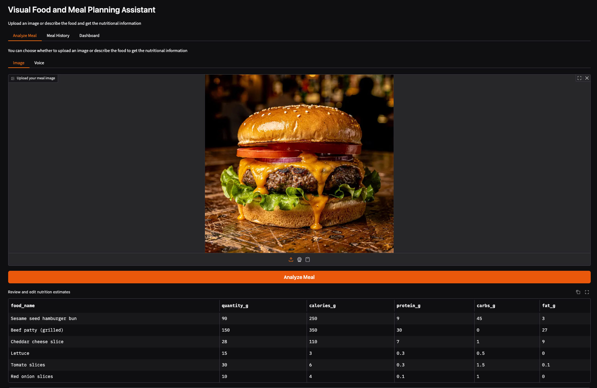
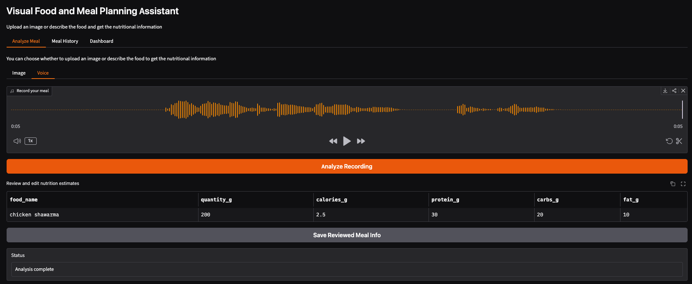
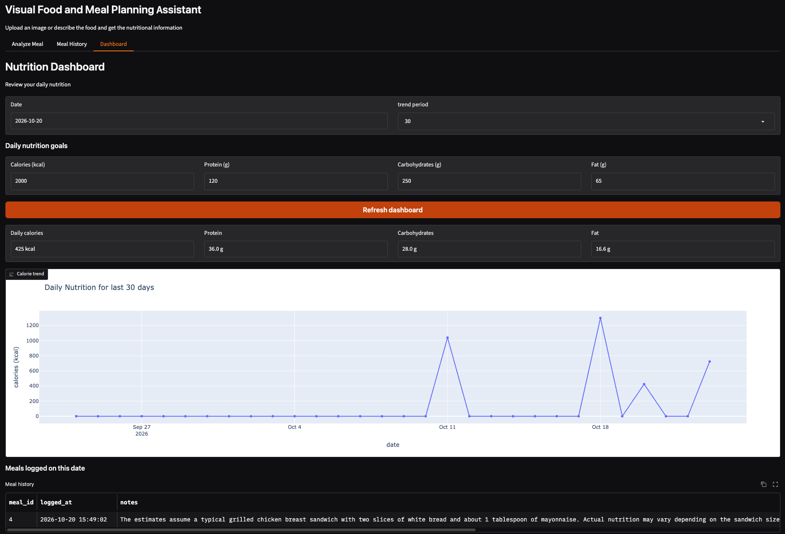

# Visual Food & Meal Planning Assistant

A multimodal nutrition assistant that helps users track their meals by uploading food images or describing meals using their voice. The application estimates nutritional values, saves meal records in SQLite, and provides a dashboard to monitor daily intake and nutrition trends.

## Features

- **Image-based meal analysis:** Upload a food image to identify foods and estimate their nutritional values.
- **Voice-based meal logging:** Record a meal description through the microphone and convert speech to text using a locally running Whisper model.
- **Nutrition analysis:** Estimate calories, protein, carbohydrates, and fat for each identified food.
- **Structured output validation:** Use Pydantic models to validate nutrition analysis results.
- **Meal history:** Save and retrieve logged meals from SQLite.
- **Nutrition dashboard:** View daily calorie intake and macronutrient totals.
- **Nutrition trends:** Track intake over the last 7 or 30 days.
- **Nutrition goals:** Configure daily nutrition targets and monitor progress.
- **Gradio interface:** Interact with the application through a simple web-based UI.

## Screenshots

### Image-Based Meal Analysis

### Voice-Based Meal Logging

### Nutrition Dashboard

## How It Works

### 1. Image-Based Meal Logging

1. Upload an image of a meal through the Gradio interface.
2. The application analyzes the image using the configured OpenAI model.
3. The model estimates the foods, quantities, and nutritional values.
4. The response is validated using Pydantic.
5. The analyzed meal can be saved to the SQLite database.

### 2. Voice-Based Meal Logging

1. Record a meal description using the microphone in the Gradio interface.
2. The audio is transcribed locally using Hugging Face Transformers and the `openai/whisper-large-v3-turbo` model.
3. The transcribed description is passed to the nutrition analysis workflow.
4. The application estimates the nutritional values of each described food separately.
5. Pydantic validates the structured response.
6. The meal can be saved to SQLite and included in the nutrition dashboard.

### 3. Nutrition Dashboard

The dashboard uses saved meal records to provide:

- Daily calorie intake.
- Daily protein, carbohydrate, and fat totals.
- Meal history organized by date.
- Nutrition trends over the last 7 and 30 days.

## Tech Stack

| Component | Technology |
|---|---|
| User interface | Gradio |
| Programming language | Python |
| Nutrition analysis | OpenAI API |
| Speech transcription | Hugging Face Transformers |
| Speech recognition model | Whisper Large V3 Turbo |
| Data validation | Pydantic |
| Database | SQLite |

## Usage

### Analyze a Meal Image

1. Open the image analysis section.
2. Upload a meal image.
3. Run the analysis.
4. Review the estimated nutritional values.
5. Save the meal to your history.

### Log a Meal Using Voice

1. Open the voice logging section.
2. Record a description of your meal.
3. Run the analysis.
4. Review the transcribed description and nutrition estimates.
5. Save the meal.

### Track Your Nutrition

1. Open the dashboard.
2. Select the relevant date or time range.
3. Review daily calorie and macronutrient totals.
4. Explore meal history and 7-day or 30-day trends.
